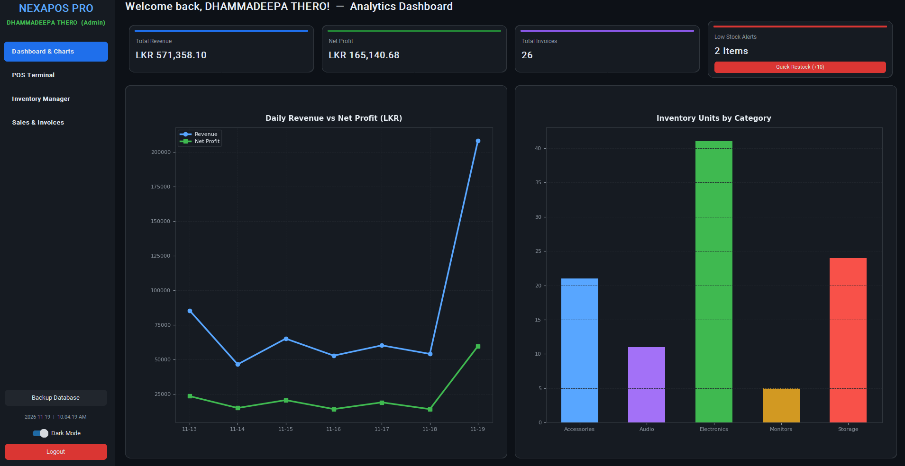

# NexaPOS Pro

NexaPOS Pro is a Windows desktop Point of Sale (POS), inventory management, and sales analytics application built with Python. I developed this project to handle real-world retail workflows—from billing customers and generating QR-verified PDF receipts to tracking stock levels and exporting financial reports to Excel—without needing an external database server.

## Download (Windows)

If you just want to try the app without installing Python, download the standalone `.exe` from the Releases page:

**[Download NexaPOS_Pro.exe (v1.0.0)](https://github.com/dhammadeepa123/NexaPOS_Pro/releases)**

*(Quick demo login: enter any name, pick Admin or Cashier, and use `1234` as the password.)*

## What It Does

* **Login & Role Access:** Supports Admin and Cashier roles with SHA-256 password hashing. Cashiers can handle billing and view stock, while Admins get full access to profit figures, inventory edits, and backups.
* **Analytics Dashboard:** Displays live revenue, net profit, invoice count, and low-stock alerts alongside Matplotlib charts for daily sales and category stock.
* **POS Billing Terminal:** Live search by product name, SKU, or category. Automatically calculates discounts and taxes, updates inventory on checkout, and prevents overselling.
* **QR-Verified PDF Invoices:** Generates a formatted tax invoice with a scannable QR code on every sale and opens it automatically. Past invoices can also be viewed and reprinted from the Sales History tab.
* **Inventory & Quick Restock:** Full CRUD support for products, automatic low-stock flagging, and a one-click `+10` restock popup directly from the dashboard.
* **Excel Reports & Backups:** Exports sales and inventory tables to `.xlsx` using Pandas and OpenPyXL, plus one-click local SQLite backups.

## Screenshots

| Login Screen | Analytics Dashboard |
| :---: | :---: |
|  |  |

| POS Terminal | QR-Verified PDF Invoice |
| :---: | :---: |
|  |  |

## Running from Source

1. Clone the repository:
   ```bash
   git clone [https://github.com/dhammadeepa123/NexaPOS_Pro.git](https://github.com/dhammadeepa123/NexaPOS_Pro.git)
   cd NexaPOS_Pro
