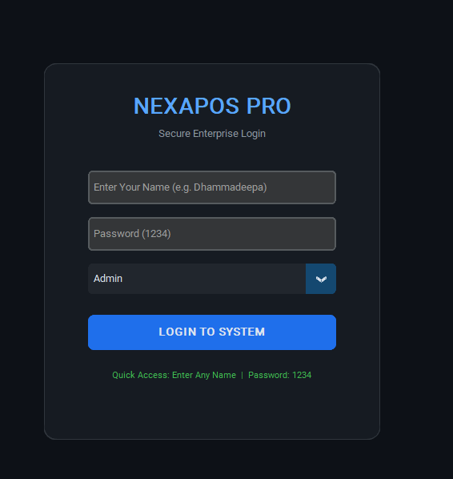
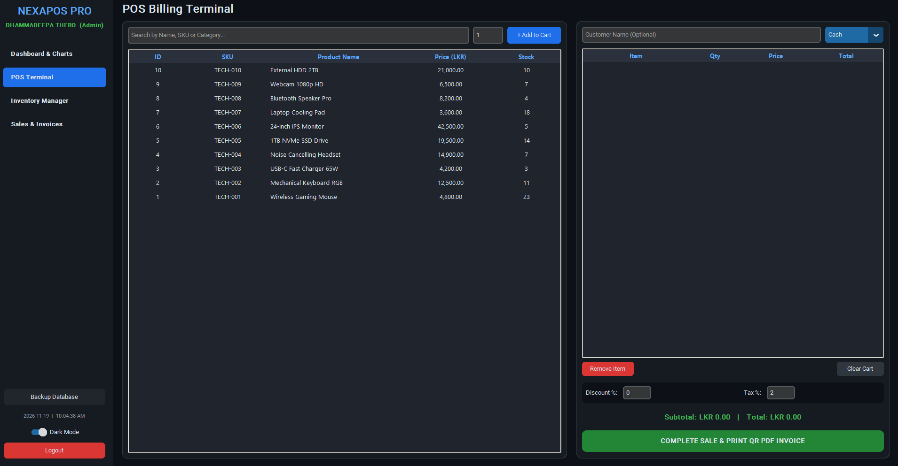

# NexaPOS Pro

NexaPOS Pro is a standalone Windows desktop Point of Sale (POS), inventory management, and sales analytics application built with Python. I developed this project to handle everyday retail workflows—from billing customers and generating QR-verified PDF invoices to tracking stock levels and exporting financial reports to Excel—all backed by a local SQLite database.

## Download (Windows)

If you want to run the app without installing Python, grab the standalone `.exe` from the Releases page:

**[Download NexaPOS_Pro.exe (v1.0.0)](https://github.com/dhammadeepa123/NexaPOS_Pro/releases)**

*(Demo login: enter any name, choose Admin or Cashier, and use `1234` as the password.)*

## Key Features

* **Role-Based Login:** Supports Admin and Cashier roles with SHA-256 password hashing. Cashiers can process sales and view inventory, while Admins have full access to net profit data, product editing, and database backups.
* **Analytics Dashboard:** Live KPI cards for revenue, net profit, total invoices, and low-stock alerts, paired with Matplotlib charts for daily sales trends and stock by category.
* **POS Billing Terminal:** Instant search by product name, SKU, or category. Automatically calculates discounts and taxes, updates stock on checkout, and prevents overselling.
* **QR-Verified PDF Invoices:** Creates a formatted tax invoice with a scannable QR code on every sale and opens it automatically. Past bills can also be inspected and reprinted from the Sales History tab.
* **Inventory & Quick Restock:** Full CRUD support for managing products, automatic low-stock alerts, and a one-click `+10` restock popup directly from the dashboard.
* **Excel Exports & Backups:** Exports sales and inventory tables to `.xlsx` via Pandas and OpenPyXL, plus one-click local SQLite backups.

## Screenshots

### 1. Login Screen


### 2. Analytics Dashboard


### 3. POS Billing Terminal


### 4. Inventory Manager


### 

## Running from Source

1. Clone the repository:
   ```bash
   git clone https://github.com/dhammadeepa123/NexaPOS_Pro.git
   cd NexaPOS_Pro
   ```

2. Install the required packages:
   ```bash
   pip install -r requirements.txt
   ```

3. Run the application:
   ```bash
   python main.py
   ```

## Tech Stack

* **UI:** CustomTkinter, Tkinter (Treeview)
* **Database:** SQLite3
* **Analytics & Exports:** Matplotlib, Pandas, OpenPyXL
* **Invoices & Security:** FPDF2, qrcode, hashlib
* **Packaging:** PyInstaller
